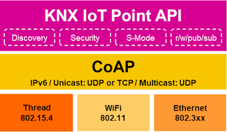

# KNX IoT Point API Stack

[](https://gitlab.knx.org/public-projects/knx-iot-point-api/knx-iot-point-api-stack/-/pipelines)
[](https://gitlab.knx.org/public-projects/knx-iot-point-api/knx-iot-point-api-stack/-/pipelines)
[](LICENSE.md)
[](https://cmake.org/)

This repository contains the C-based KNX IoT Point API stack used by device applications and demo projects. For a conceptual overview, see also [Build with KNX IoT](https://buildwithknxiot.knx.org/public-projects/knx-iot-docs/).

A common stack introduction and ETS6 commissioning guidance is available on the [KNX IoT documentation pages](https://buildwithknxiot.knx.org/public-projects/knx-iot-docs/). The stack is typically consumed by the [KNX IoT Point API Demos](https://gitlab.knx.org/public-projects/knx-iot-point-api/knx-iot-point-api-demos), while this repository is the implementation and test surface for the reusable core.

## What Is This?

The [Point API Schema](https://gitlab.knx.org/public-projects/knx-iot-point-api/knx-iot-point-api-schema) provides a mapping of KNX application data to a RESTful resource model and CBOR/JSON-based data representation. Devices use this representation to communicate over CoAP/UDP and IP. The Point API contains the following building blocks: Discovery, Security, S-Mode messaging and read/write/subscribe access to parameter and diagnostic properties.



**Discovery** — resource discovery over CoAP unicast/multicast or mDNS. A well-known resource URI returns links to the functional blocks and properties hosted by a server, filtered by attributes.

- Device discovery via DNS-SD and mDNS (RFC 6762)
- Semantic discovery of functional blocks per KNX Volume 7

**Security** — OSCORE secure group communication and property access.

- OSCORE (RFC 8613) for application-layer security across unicast, multicast, and low-latency communication
- SPAKE2+ (RFC 9383) for password-based mutual authentication and session key derivation (PASE)

**Point Read/Write/Publish/Subscribe** — each parameter and diagnostic property (sensor, actuator, setpoint, diagnostic value) has a unique URI for direct access (GET), update (PUT), or subscription (Observe).

- Interoperable with non-KNX systems via standard CoAP (RFC 7252)
- Flexible content formats: CBOR (RFC 8949) and JSON (RFC 8259)

**Group Communication (S-Mode)** — a producer sends a message to notify consumers of a change; no direct response is required, and any response arrives as a separate group event. ETS configures group events via group tables.

- Integrates with KNX Classic and is compatible with ETS
- CoAP/UDP for resource-constrained devices, with efficient memory and message-size handling
- Unicast and multicast over CoAP/UDP for low-latency applications

## Features

- **Client and Server APIs** for KNX IoT applications, resources, discovery, and device services
- **Tailored CoAP Stack** with Core Link Format and CBOR support for Point API resource exchange
- **OSCORE Security** resource handlers and crypto integration for secured communication
- **mDNS / DNS-SD Support** including KNX IoT specific subtypes such as `'_pm._sub._knx._udp.local.'`
- **Portable Platform Layer** for logging, clocks, random data, storage, and network integration
- **Multi-Platform Ports** for Windows, Linux, and Zephyr, with FreeRTOS documented separately
- **Standalone Test Infrastructure** with Google Test unit tests and Python runtime conformance tests

## Contributing

Improvements are welcome. Please read the [Contributing Guide](CONTRIBUTING.md) before submitting changes.

## License

[Apache License Version 2.0](LICENSE.md)

## Quick Start

**Looking for a runnable application?** The fastest path is usually the [KNX IoT Point API Demos](https://gitlab.knx.org/public-projects/knx-iot-point-api/knx-iot-point-api-demos), which consume this stack via CMake `FetchContent` and include end-to-end usage flows.

For standalone stack builds, local development, or test execution, use the setup below.

### Prerequisites

- **CMake** 3.21 or newer
- **Ninja** generator
- **A supported C/C++ toolchain**: MSVC, GCC, or MinGW cross-compilation depending on the preset
- **Python** and **Docker** if you want to run the runtime conformance suite

### Building

The project ships with [CMake Presets](https://cmake.org/cmake/help/latest/manual/cmake-presets.7.html) for Windows, Linux, cross-compilation, and test builds.

```bash
cmake --list-presets
cmake --preset <preset-name>
cmake --build --preset <preset-name>
```

Common examples:

```bash
cmake --preset linux-debug-gcc
cmake --build --preset linux-debug-gcc
```

Test-enabled presets are also available, including `windows-test-gcc`, `linux-test-gcc`, `linux-test-asan` and `linux-test-asan-clang`. Both sanitizer test presets run with `UBSAN_OPTIONS=halt_on_error=1`, so any UndefinedBehaviorSanitizer report fails the test that triggered it; `linux-test-asan-clang` builds the same suite with clang, whose UBSan also catches what GCC's misses (such as arithmetic on a NULL pointer).

#### In Docker

To build and test on Linux without installing a toolchain, use the CI image in [`docker/Dockerfile`](docker/Dockerfile). [docs/docker.md](docs/docker.md) describes all jobs:

```bash
docker build -t knx-iot-stack -f docker/Dockerfile .
docker run --rm knx-iot-stack     # build + unit tiers (gcc, ASan, clang ASan), as in CI
```

### Usage

This repository primarily builds the reusable stack library and supporting test binaries. Device applications typically include it as a dependency rather than running it directly. [docs/application-integration.md](docs/application-integration.md) describes how an application integrates the stack. For application-level workflows, ETS6 commissioning, and example devices, see the [KNX IoT Point API documentation pages](https://buildwithknxiot.knx.org/public-projects/knx-iot-docs/pointapi/introduction/) and the demos repository.

## Running Tests

### Unit Tests

Enable tests with one of the `*-test-*` presets, build, and run CTest:

```bash
cmake --preset linux-test-gcc
cmake --build --preset linux-test-gcc
ctest --preset linux-test-gcc
```

Replace the preset name with the matching GCC or Linux test preset as needed.

#### Coverage

The `*-coverage-gcc` presets build the same unit suite with gcov instrumentation
(`--coverage -O0`, CMake option `ENABLE_COVERAGE`). Run it, then let
[gcovr](https://gcovr.com) (`pip install gcovr`) turn the `.gcda` files into a
report; the filters restrict it to the stack's own code, leaving out tests,
fetched dependencies, the vendored `src/util/c-timestamp` parser and
`src/resources/ri/oc_test_control.c` (test endpoints of the device used by the runtime and
conformance tiers, not part of the product):

```bash
cmake --preset linux-coverage-gcc          # windows-coverage-gcc on MSYS2/MinGW
cmake --build --preset linux-coverage-gcc
ctest --preset linux-coverage-gcc
gcovr --root . --filter 'src/resources/' --filter 'src/core/' --filter 'src/messaging/' --filter 'src/security/' --filter 'src/util/' \
      --exclude 'src/util/c-timestamp/.*' --exclude 'src/resources/ri/oc_test_control[.]c' --print-summary \
  --html-medium-threshold 65 --html-high-threshold 85 \
      --html-details build/linux-coverage-gcc/coverage-html/index.html build/linux-coverage-gcc
```

In CI the `unit-coverage-gcc` job does this on every push; GitLab shows the function
percentage on the job and the merge request, and the HTML report is an artifact.
The summary also prints line and branch coverage. Branches are the figure to
watch for error paths: an untested `if (len > max) return error;` is a covered
line but an untaken branch. The job fails below 62 % branch coverage
(`--fail-under-branch`, just under the current value), so a change that drops
tested error paths shows up there.

#### Function complexity

`tests/common/tools/lizard_report.py` runs [lizard](https://github.com/terryyin/lizard)
(`pip install lizard==1.26.0 jinja2`) over the stack's own C code as a statistic: it
writes an HTML and a CSV report (one row per function), lists the functions over
a cyclomatic complexity of 15, 150 lines or 7 parameters and prints the summary.
Fun Rt (share of functions over a threshold) and nloc Rt (share of the code in
them) are the figures to follow from release to release. It fails nothing; the
CI job `quality-code` runs it and keeps the reports as artifacts.

```bash
python3 tests/common/tools/lizard_report.py --out build/lizard
```

With `--diff [BASE]` (default `origin/main`) it checks only the functions whose
lines changed since the merge base, uncommitted work included: a new function
must stay within the thresholds, a changed one already over a threshold must
not get worse on it. It exits 1 otherwise. A touched function over a
threshold that got no better is listed as `WARN` with the changed lines, the
block to extract first; it does not fail. The CI job `quality-code` runs
the check on every branch against the default branch.

```bash
python3 tests/common/tools/lizard_report.py --diff origin/main
```

For deciding where a refactoring pays off first, set the complexity per file
(the CSV's `ccn` summed per file) against how often the file changes
(`git log --no-merges --since="2 years ago" --name-only`, without mechanical
commits such as formatting or license headers): a file that is both complex
and often changed is a hotspot, a complex file nobody touches is not.

#### Code format

The changed lines must match `.clang-format`; untouched code is not checked.
The CI job `quality-code` runs this on every branch against the merge base
with the default branch, with clang-format 22 (`pip install clang-format==22.1.8`);
a failure prints the diff that fixes it. Locally, before pushing:

```bash
git clang-format --diff $(git merge-base origin/main HEAD)   # check
git clang-format $(git merge-base origin/main HEAD)          # fix the working tree
```

`git clang-format` does not detect renames, so it checks a moved file as a whole. CI
therefore runs the rename-aware form, which also works locally:

```bash
git diff -M -U0 --no-color $(git merge-base origin/main HEAD) | clang-format-diff.py -p1 \
  -regex '(?!src/util/c-timestamp/|include/util/pt/|src/port/mdns/mdns\.h$)(src|include)/.*\.[ch]'
```

### Runtime Conformance Tests

Runtime tests exercise the full stack over real CoAP/OSCORE on IPv6 and build a `runtime_test_server` device under test. They come in two tiers: the conformance tier plays KNX's conformance-test template against the device with the [KNX IoT Point API Test Tool](https://gitlab.knx.org/public-projects/knx-iot-point-api/knx-iot-point-api-test-tool) (git submodule `tests/iot-test-tool`, with this stack's override files in `tests/conformance/`), and `tests/runtime/` holds hand-written tests for behaviour the template does not cover. Both share `tests/common/`. Fetch the tool once with `git submodule update --init tests/iot-test-tool`. They run in Docker only: the device needs its own network namespace and a veth pair with unique local addresses, which the runners create exactly as the CI jobs `conformance-gcc` and `runtime-gcc` do; see `tests/README.md` for the map.

Windows (PowerShell) and Linux, macOS or Git Bash have a runner each with the same options:

```powershell
.\tests\common\tools\run-in-docker.ps1                       # both device tiers, committed HEAD
.\tests\common\tools\run-in-docker.ps1 -Tier conformance     # the conformance tier
.\tests\common\tools\run-in-docker.ps1 -Tier runtime         # the hand-written tier
.\tests\common\tools\run-in-docker.ps1 -Tier conformance -Section 5.6 -IncludeUncommitted
.\tests\common\tools\run-in-docker.ps1 -Tier runtime tests/runtime/test_observe.py -x
```

```bash
tests/common/tools/run-in-docker.sh                          # both device tiers, committed HEAD
tests/common/tools/run-in-docker.sh --tier conformance
tests/common/tools/run-in-docker.sh --tier runtime
tests/common/tools/run-in-docker.sh --tier conformance --section 5.6 --uncommitted
tests/common/tools/run-in-docker.sh --tier runtime -- tests/runtime/test_observe.py -x
```

`all` (the default) runs the two tiers as separate pytest processes, each against a fresh device. Select parts of the template with the section option, not with `-k`: pytest's `-k 5.6` also matches 5.5.5.6. By default the committed HEAD is tested (with the tool at the commit HEAD pins); `-IncludeUncommitted` / `--uncommitted` packs the working tree, the tool's checkout included. `-Tier tool` / `--tier tool` runs the tool's own no-device tests. Both runners hand the container `tests/common/tools/run-local-ci.sh`, which is also usable directly inside a Linux CI container.

### Fuzz Tests

The fuzz tier runs libFuzzer harnesses (`tests/fuzz/`) against the code that processes attacker-controlled bytes: before any credential check the CoAP and OSCORE option parsing, the CBOR `oc_rep` tree, the query and number parsers, mDNS, blockwise reassembly and the SPAKE2+ handshake; on a fully initialised stack the complete inbound datagram path, decrypted OSCORE requests from a peer holding a credential, and the resource handlers (device, tables, access tokens, load state machine, software update, observe, `/k`). It needs clang; the seed corpus is generated into the build tree by `make_corpus.py`, so no binary blobs are committed.

```bash
cmake --preset linux-fuzz-clang
cmake --build --preset linux-fuzz-clang
ctest --preset linux-fuzz-clang
```

CTest replays every seed exactly once (`-runs=0`) under the `fuzz` label, so the gating run is deterministic. To actually mutate, run a harness directly with its corpus:

```bash
cd build/linux-fuzz-clang/tests/fuzz
./fuzz_coap_parse corpus/coap_parse -max_total_time=300
```

New crashes land in `artifacts/`. In CI, `fuzz-seed-replay` gates on the seed replay and reports source coverage; `fuzz-explore` is a manual longer mutation run. Both run every harness CTest registers, so a new harness only needs its entry in `tests/fuzz/CMakeLists.txt` and its seeds in `make_corpus.py`.

## Project Structure

```text
include/                 public headers, the only include root an application needs
  messaging/coap/        CoAP/OSCORE types and constants the public API exposes
  port/                  platform abstraction interface (clock, log, storage, network, DNS-SD)
  security/              access token types
  util/                  lists, memory pools, timers, processes, protothreads
src/                     the stack's production code (private)
  resources/knx/         KNX Point API resources, s-mode and KNX security tables
  resources/ri/          resource registry, dispatch, client/server API, discovery, CBOR
  core/                  stack lifecycle, message routing, network events, timers
  messaging/coap/        tailored CoAP implementation, blockwise and OSCORE message handling
  security/              OSCORE and SPAKE2+ security implementation
  util/                  low-level internal primitives used by the core framework
  port/                  shared platform abstractions and OS-specific adaptations
    linux/               Linux port
    windows/             Windows port
    zephyr/              Zephyr port
    freertos_esp32/      FreeRTOS/ESP-IDF port
zephyr/                  Zephyr module glue (module.yml, CMakeLists.txt, Kconfig)
esp-idf/knx_iot/         ESP-IDF component glue
tests/unit/              Google Test unit tests
tests/common/            shared Python test infrastructure + the DUT's C source
tests/conformance/       this stack's override files for the conformance-test tool
tests/iot-test-tool/     the conformance-test tool (git submodule): runner, GUI, CoAP/OSCORE client
tests/runtime/           hand-written network-level conformance tier
tests/fuzz/              libFuzzer harnesses for the pre-authentication parsers
tests/docs/              runtime test walkthroughs and supporting notes
docs/                    stack documentation and migration guides
cmake/                   helper CMake modules and toolchain files
```

Key areas:

- **`src/resources/`** implements the CoAP resources: `knx/` the KNX Point API resources, `ri/` the resource registry and dispatch, client/server APIs, discovery, and CBOR encode/decode helpers.
- **`src/core/`** runs the stack: lifecycle, message routing, endpoints and network events.
- **`src/messaging/coap/`** contains the CoAP engine tailored for the stack.
- **`src/security/`** contains the security model implementation, including OSCORE.
- **`include/oc_api.h`** exposes the main client/server APIs.
- **`include/oc_rep.h`** provides CBOR encode/decode helpers.
- **`include/oc_helpers.h`** contains utilities for strings and arrays backed by heap or memory pools.
- **`include/port/*.h`** defines shared abstractions for DNS-SD, clocks, logging, storage, and networking; the platform's `oc_config.h` stays in its port directory (`src/port/<platform>/`).

An application puts `include/` and its platform's port directory on the include path; linking `kisClientServer` does both. The CTest `PublicHeaders.*` checks that every public header compiles with only these.

How these parts work together — the layers and their boundaries, the single-threaded runtime model, the send and receive flows, OSCORE replay protection, SPAKE2+ etc. is described in [docs/software-design.md](docs/software-design.md).

## Further Documentation

| Document | Description |
| -------- | ----------- |
| [KNX IoT documentation pages](https://buildwithknxiot.knx.org/public-projects/knx-iot-docs/) | Stack introduction, ETS6 workflows, and broader Point API documentation |
| [docs/application-integration.md](docs/application-integration.md) | Step-by-step guide to building a device application on the stack: identity, start-up, event loop and threading, datapoints, group messages, software update |
| [docs/software-design.md](docs/software-design.md) | Software architecture and design: layers, runtime model, message flows, OSCORE and SPAKE2+ |
| [tests/README.md](tests/README.md) | Map of the five test tiers and how to run each |
| [KNX IoT Point API Test Tool](https://gitlab.knx.org/public-projects/knx-iot-point-api/knx-iot-point-api-test-tool) | The conformance-test tool (submodule `tests/iot-test-tool`): runner, browser GUI, run records |
| [tests/runtime/README.md](tests/runtime/README.md) | Runtime conformance test setup and execution |
| [tests/docs/runtime-test-walkthrough.md](tests/docs/runtime-test-walkthrough.md) | Walkthrough of the runtime test environment |
| [docs/mbedtls_3.x_to_4.x_migration.md](docs/mbedtls_3.x_to_4.x_migration.md) | Migration notes for Mbed TLS 4.x |
| [CONTRIBUTING.md](CONTRIBUTING.md) | Contribution workflow and CLA |

## Technologies Used

- C and CMake
- CoAP, Core Link Format, and CBOR
- OSCORE and SPAKE2+
- [Mbed TLS](https://github.com/Mbed-TLS/mbedtls) (crypto library for OSCORE and SPAKE2+)
- [TinyCBOR](https://github.com/intel/tinycbor)
- Google Test for unit tests
- Python and pytest for runtime conformance tests
