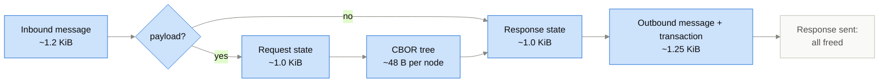
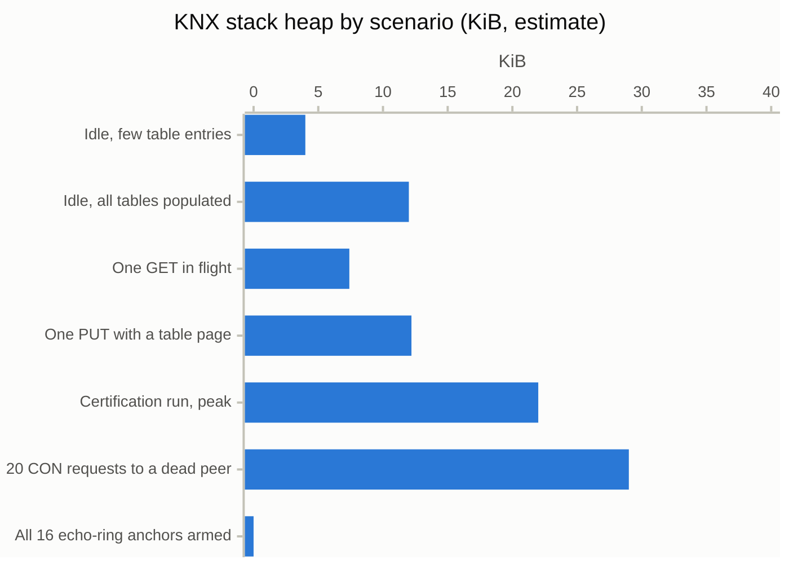
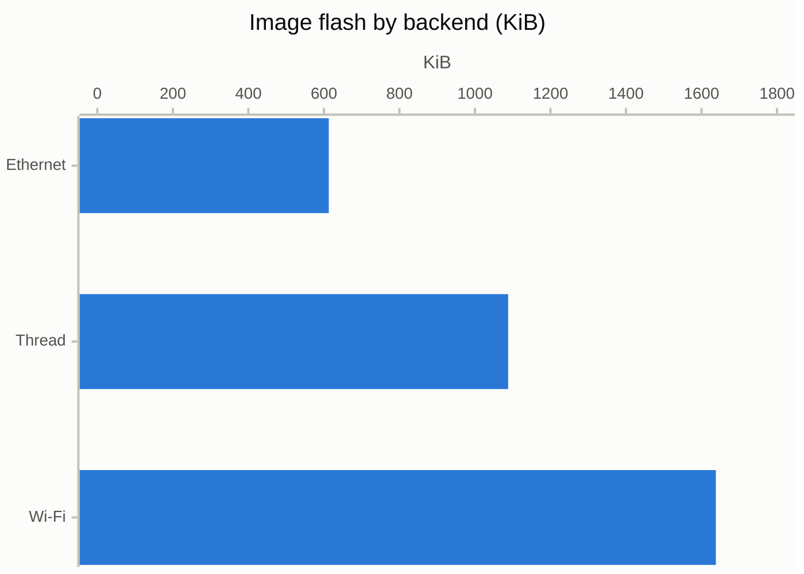
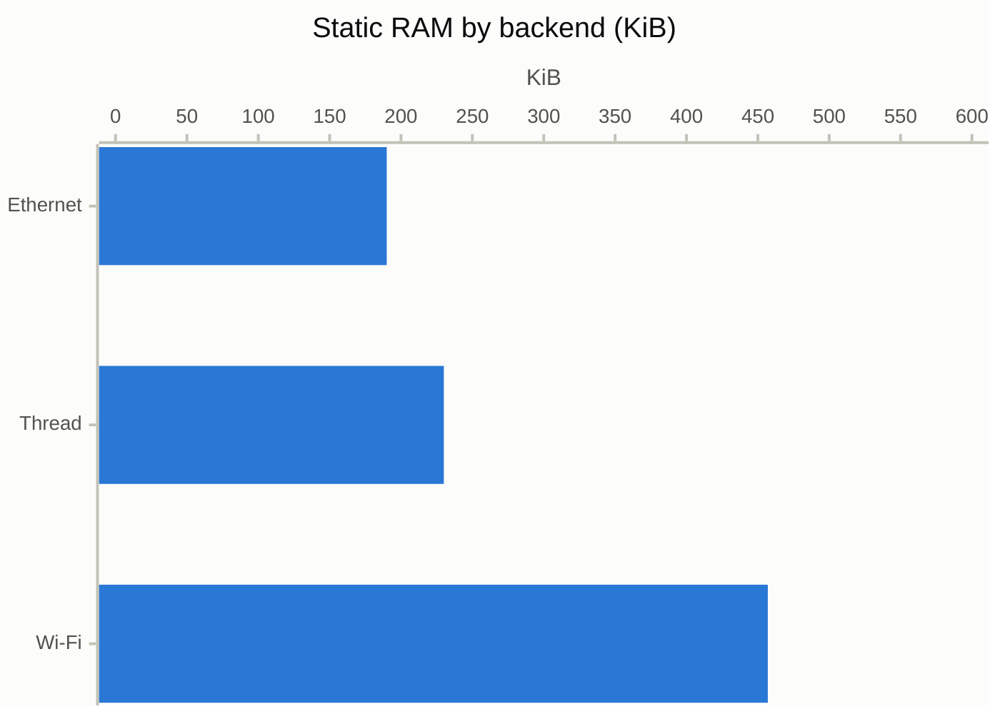
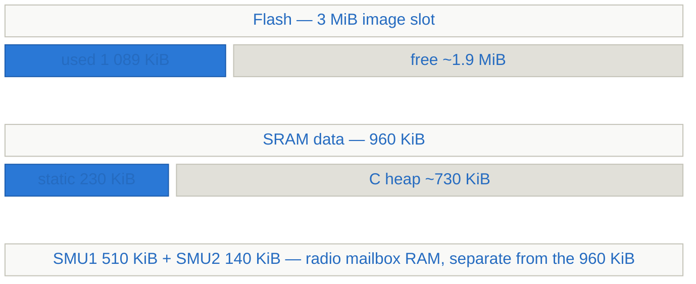
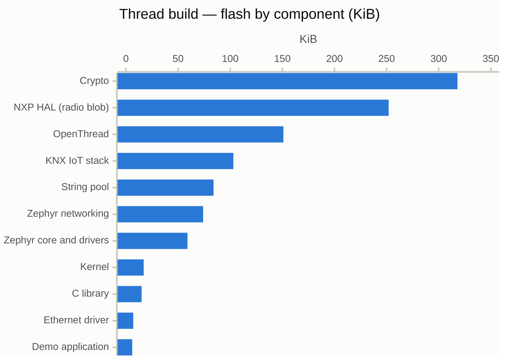
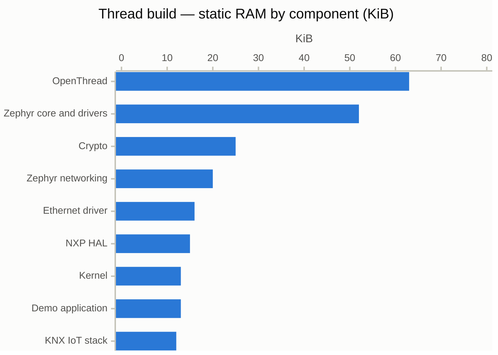

# KNX IoT Point API Stack — Memory Footprint

**At a glance** (32-bit Cortex-M33, Zephyr 4.5, `-Os`)

- **Smallest complete Thread device (FRDM-MCXW72): 562 KiB flash, 162 KiB
  static RAM as a development build; 361 KiB / 121 KiB in a production
  configuration (§ 4).**
- **The KNX IoT stack alone: 102 KiB flash on Thread, 110 KiB on Ethernet and
  Wi-Fi (73 / 79 KiB in production), 12–27 KiB static RAM, heap peak
  ~24 KiB.**
- **Preliminary, FreeRTOS (ESP-IDF) on ESP32-C6: ~1.1 MiB flash and ~150 KiB
  static RAM for a complete Thread or Wi-Fi device in development, 781–846 KiB
  and 99–137 KiB in production; the KNX IoT stack takes 158–166 KiB flash
  (92–97 KiB in production) and 13–15 KiB static RAM there (§ 10).**

## 1. Conditions

Every figure in this document holds for the build described below and will
move as the stack evolves. For a first estimate it is sufficient.

| Condition | Value used here |
| --- | --- |
| Stack revision | Totals (§ 2, § 4, § 9.1, § 10): `8a63764e` (2026-11-18), demo applications at `0567ecb`. Per-object and per-component breakdowns (§ 5, § 6, § 9.2, § 9.3): `829d68d1` (2026-11-11), demo applications at `e7041fa`; the totals of both revisions agree within 1 KiB. `KNX_PAYLOAD_SIZE` 768 B, CoAP PDU ~1 040 B |
| Toolchain and RTOS | Zephyr 4.5.0, Zephyr SDK 1.0.1 (GCC 14.3), 32-bit Cortex-M33 |
| Optimisation | `-Os` (`CONFIG_SIZE_OPTIMIZATIONS=y`) for every figure unless marked `-O2`. The NXP board configurations of the demo applications ship with `CONFIG_SPEED_OPTIMIZATIONS=y` (`-O2`, to meet the EITT timings); those images are larger and are listed alongside (§ 2, § 4, § 9.1) |
| Configuration | **Development**: shell and OpenThread CLI on, 24 KiB log buffer, Zephyr logging at INFO, KNX stack logging at WARNING (`CONFIG_KNXIOT_LOG_LEVEL=2`), OpenThread diagnostics on; the Thread builds are Minimal Thread Devices. **Production**: the overlay listed in § 4, measured as a whole; the per-item savings of § 4 are estimates |
| Echo ring size | 16 slots, the default of `CONFIG_KNXIOT_ECHO_RING_SIZE` (Zephyr) and of the top-level CMake `KNX_ECHO_RING_SIZE` (other ports). A slot retains no heap (§ 7.2) |
| Estimated since | `9ad66c3f` + working tree (2026-11-10), marked `~` in § 7.2: a cached response is cut to its bytes (`realloc`), `oc_resource_t` without the unused property callbacks (−16 B), received CBOR nesting capped (`KNX_CBOR_MAX_DEPTH`). `OC_PRINT` now also needs `CONFIG_LOG`, which the measured development configuration has on; with logging off the stack is 8 KiB smaller (§ 4) |
| Measured delta | `origin/main` `4799d341` against `cde9b9d0` + working tree (2026-11-15): three pristine builds of the `lsab` demo on FRDM-RW612 (Ethernet, the demo's own configuration), same Docker image, `arm-zephyr-eabi-size` on `zephyr.elf` and on each object of `libknx_iot_stack.a`. Stack: text −749 B (198 419 → 197 670, object text includes its string literals), `.data` −416 B (core-resource `rt` arrays now `.rodata`), `.bss` +1 092 B (observer pool, 8 × 136 B, before on the heap; +4 B PASE state); stack flash (text + data) −1.1 KiB. Image flash 537 628 → 535 840 B (−1.7 KiB). Largest moves: `spake2plus` −1 809 B, `oc_knx_dev` −2 184 B, `oc_rep` +1 859 B, new `oc_knx_observe` 983 B, `oc_knx_publisher` 843 B, `oc_knx_hooks` 405 B. Measured on the earlier Zephyr 4.4.1 / GCC 12 build, so it is not applied to the per-object figures measured at `829d68d1` (§ 5, § 6). Confirmed by the totals at `8a63764e`: the stack is 1 KiB smaller in flash and 0.9 KiB larger in static RAM than at `829d68d1` |
| KNX table sizes | certification defaults: 50 group objects, 20 publishers, 20 recipients, 20 access tokens |
| Application | EITT certification demo, 5 datapoints |
| Boards measured | NXP FRDM-RW612 (Ethernet, Wi-Fi, Thread), NXP FRDM-MCXW72 (Thread, 256 KB RAM) |
| Measured vs estimated | Flash and static RAM: measured from the linked images, built 2026-11-18 (totals) and 2026-11-12 (breakdowns). Heap and the struct sizes behind it (§ 7): estimated from the allocation model, not measured again; confirm on a device with `knx_iot heap` (§ 8). `~` marks an estimate |
| FreeRTOS (ESP-IDF) | **Preliminary**, § 10 only: the port is in beta; one development and one production image per backend, built 2026-11-18, not yet analysed in the depth of the Zephyr figures. Every other section describes the Zephyr builds |
| Other targets | Other 32-bit MCUs land close to these numbers; 64-bit hosts run larger because pointer-heavy structs roughly double |

## 2. What you need

### 2.1 The KNX IoT stack alone

| | Ethernet, Wi-Fi | Thread |
| --- | --- | --- |
| **FLASH** | 110 KiB | 102 KiB |
| **FLASH, built with `-O2`** | 132 KiB | 122 KiB |
| **FLASH, production (§ 4)** | 79 KiB | 73 KiB |
| **RAM, static** | 27 KiB | 12 KiB |
| **RAM, stack thread** | 12 KiB | 12 KiB |
| **RAM, crypto heap (Mbed TLS)** | 15 KiB | 15 KiB |
| **RAM, heap, idle → certification peak** | 4 → ~24 KiB | 4 → ~24 KiB |
| **RAM, total** | **~58–78 KiB** | **~43–63 KiB** |

The flash and static RAM difference between the two columns is the discovery
mechanism (§ 3).
"Certification peak" is the heaviest moment of a KNX IoT
conformance run with the EITT tool, three requests overlapping plus one pending
ACK and one notification; it is the realistic upper bound for normal operation
and is itemised in § 7.4.

### 2.2 A complete device

The stack is a small part of a device image. These are **complete firmware
images**: Zephyr kernel, shell, logging, settings and flash storage, the Zephyr
network stack, Mbed TLS and PSA crypto with the NXP crypto drivers, the vendor
HAL with its radio firmware, the network backend (OpenThread, or the Wi-Fi
driver with the WPA supplicant), the demo application and the KNX IoT stack.
The network backend decides most of the total.

| Backend, board | FLASH, development | FLASH, as shipped (`-O2`) | FLASH, production | RAM static, development | RAM static, production | Fits |
| --- | --- | --- | --- | --- | --- | --- |
| Ethernet, RW612 | **613 KiB** | 695 KiB | 435 KiB | **190 KiB** | 150 KiB | 1 MiB flash, 320 KiB RAM class MCU |
| Thread, RW612 | **1 088 KiB** | 1 194 KiB | 886 KiB | **230 KiB** | 188 KiB | 2 MiB flash, 384 KiB RAM; 224 KiB of the flash is radio firmware |
| Thread, MCXW72 | **562 KiB** | 661 KiB | 361 KiB | **162 KiB** of 232 usable | 121 KiB | a 256 KB part works; ~70 KiB heap left in development, ~110 KiB in production |
| Wi-Fi, RW612 | **1.6 MiB** | 1.8 MiB | 1.2 MiB | **457 KiB** (525 KiB with `-O2`) | 397 KiB | 2 MiB flash, 768 KiB RAM; 347 KiB radio firmware plus WPA supplicant |

The Thread builds are Minimal Thread Devices (MTD), non-routing end devices.
With `-O2` the static RAM is the same within 2 KiB, except on Wi-Fi, where the
code relocated to SRAM grows from 9 to 76 KiB.

Of these totals the KNX stack is 102–110 KiB of flash and 12–27 KiB of static
RAM (§ 2.1); everything else is platform: Zephyr and its subsystems, crypto,
and the backend (§ 9.2 breaks it down). Add the C heap on top of static RAM:
the stack alone peaks at ~24 KiB, the network stacks take more, and a
comfortable device leaves 100 KiB or more.

## 3. Why the numbers differ

**The backend, not the stack, sets the size of a device.** Ethernet needs no
radio firmware. Thread adds OpenThread (~150 KiB flash, ~63 KiB RAM) and a
224 KiB radio firmware blob on the RW612. Wi-Fi adds a 347 KiB radio firmware
blob, the Wi-Fi driver, the WPA supplicant and IPv4/TCP support, together about
1 MiB of flash and 270 KiB of RAM more than Ethernet. The KNX stack is the same
code in every image.

**Discovery costs the stack 8 KiB of flash and ~15 KiB of RAM more on Ethernet
and Wi-Fi than on Thread.** Every KNX IoT device must be discoverable by
DNS-SD. On Ethernet and Wi-Fi the device is its own mDNS responder: a small DNS
server with a listener thread, packet buffers and a socket, identical on both.
On Thread the device registers once with the border router's SRP server, and
the router's advertising proxy publishes the records as mDNS on the LAN;
OpenThread already contains the SRP client, so the port needs ~2 KiB and no
buffers or thread. What a PC on the LAN sees is the same in every case.

**Development versus production is worth about 180–200 KiB of flash and
40 KiB of RAM, on Wi-Fi 400 KiB and 60 KiB (measured, § 4).** Shell,
OpenThread CLI, logging with its buffer and format strings, and OpenThread
diagnostics are tooling; § 4 lists each item and the switch that removes it.
Building with `-O2` instead of `-Os` costs another 80–180 KiB of flash.

---

## Details

## 4. Development versus production configuration

Unless marked as production, every number in this document was measured with
the development configuration the demo applications ship with, compiled with
`-Os`; what makes it "development" is the tooling left switched on. The NXP
boards of the demo applications ship with `-O2`, the first row below. The
per-item savings below are estimates from the component sizes in § 9, except
where marked measured; the production configuration as a whole was measured
(second table).

| Development item | Flash | RAM | Turned off by |
| --- | --- | --- | --- |
| `-O2` → `-Os` (measured) | 82 KiB Ethernet, 106 KiB Thread RW612, 99 KiB Thread MCXW72, 178 KiB Wi-Fi; ~20 KiB of it is the KNX stack | ≤ 2 KiB; 68 KiB on Wi-Fi (code relocated to SRAM) | `CONFIG_SIZE_OPTIMIZATIONS=y` instead of `CONFIG_SPEED_OPTIMIZATIONS=y` |
| Zephyr shell with KNX and kernel commands | ~20 KiB | ~6 KiB (shell stack, context) | `CONFIG_SHELL=n` |
| OpenThread CLI (Thread only) | ~25 KiB | ~1 KiB | `CONFIG_OPENTHREAD_SHELL=n` |
| Log ring buffer 24 KiB → 4 KiB | — | ~20 KiB | `CONFIG_LOG_BUFFER_SIZE` |
| INFO-level log strings (the image-wide string pool, § 5) | ~30–60 KiB | — | `CONFIG_LOG_DEFAULT_LEVEL=2` (the KNX stack is already at `CONFIG_KNXIOT_LOG_LEVEL=2`) |
| KNX print helpers (CBOR-to-JSON dump of request payloads, table and access-token dumps) | 8 KiB of the stack (lssb, shell and logging off, measured) | — | `CONFIG_LOG=n` |
| OpenThread diagnostics: link metrics, time sync, ping (Thread only) | ~5 KiB | ~2 KiB | `CONFIG_OPENTHREAD_LINK_METRICS_*=n`, `_TIME_SYNC=n`, `_PING_SENDER=n` |
| NVS lookup cache 1024 → 256 slots | — | ~3 KiB | `CONFIG_NVS_LOOKUP_CACHE_SIZE` |
| KNX tables sized to the product instead of the certification defaults | — | ~2–4 KiB | `CONFIG_KNXIOT_*_MAX_ENTRIES` |
| HTTP server when soft-AP provisioning is unused (Wi-Fi only) | 23 KiB (measured) | 11 KiB (measured) | `CONFIG_HTTP_SERVER=n` |

The production configuration measured here applies all rows except the table
sizes, on top of the demo applications' configuration with its development
lines removed: `CONFIG_SIZE_OPTIMIZATIONS=y`, `CONFIG_LOG=n`, `CONFIG_SHELL=n`,
`CONFIG_PRINTK=n`, `CONFIG_ASSERT=n`, `CONFIG_BOOT_BANNER=n`,
`CONFIG_NVS_LOOKUP_CACHE_SIZE=256`, `CONFIG_KNXIOT_LOG_LEVEL=0`; on Thread also
`CONFIG_OPENTHREAD_SHELL=n`, `CONFIG_OPENTHREAD_LINK_METRICS_INITIATOR=n`,
`_LINK_METRICS_SUBJECT=n`, `_PING_SENDER=n`, `_TIME_SYNC=n`; on Wi-Fi also
`CONFIG_HTTP_SERVER=n`. Same EITT application, same table sizes, built
2026-11-18 at `8a63764e`:

| Backend, board | Development (`-Os`) | Production (measured) | Saved |
| --- | --- | --- | --- |
| Ethernet, RW612 | 613 KiB flash / 190 KiB RAM | 435 KiB / 150 KiB | 178 / 40 KiB |
| Thread, RW612 | 1 088 KiB / 230 KiB | 886 KiB / 188 KiB | 202 / 42 KiB |
| Thread, MCXW72 | 562 KiB / 162 KiB | 361 KiB / 121 KiB, leaving ~110 KiB heap instead of ~70 KiB | 201 / 41 KiB |
| Wi-Fi, RW612 | 1 638 KiB / 457 KiB | 1 231 KiB / 397 KiB | 407 / 60 KiB |

On Ethernet the 178 KiB split into 57 KiB of the image string pool (log
format strings, 67 → 10 KiB), 31 KiB of the KNX stack, 30 KiB of Zephyr core (logging,
shell), 32 KiB of the network stack (its shell commands and logging) and the
rest in the C library, kernel and drivers. The RAM saving is almost all Zephyr
core: log buffer and shell. On Wi-Fi the vendor HAL (58 KiB flash, 9 KiB RAM,
its logging), the Wi-Fi L2 shell (26 KiB) and the HTTP server (23 / 11 KiB)
add to that.

On the FRDM-RW612 Thread image the production configuration does not build
as is: with `CONFIG_PRINTK=n` the NXP HAL's BLE platform code fails to compile
(`fsl_debug_console.h` not found), and with `CONFIG_OPENTHREAD_SHELL=n` the
OpenThread Spinel host library fails to link (`otThreadErrorToString`,
`otLinkGetFrameCounter` undefined, a link-order problem). The figures above
were built with `CONFIG_PRINTK=y` and the two symbols forced in by the linker
(`-Wl,-u,<symbol>`); a product needs the same or a fix in the demo
applications. The other three images built unchanged.

The KNX stack itself shrinks from 110 to 79 KiB of flash (Ethernet, Wi-Fi)
and from 102 to 73 KiB (Thread): `CONFIG_KNXIOT_LOG_LEVEL=0` removes its
warning and error calls with their strings, `CONFIG_LOG=n` the print helpers,
`CONFIG_SHELL=n` its shell commands. Its RAM does not depend on the
configuration beyond the table sizes.

## 5. Flash

| Area | Flash | Objects |
| --- | --- | --- |
| KNX resources (`/fp`, `/auth`, `/dev`, `/.knx`, `/p`, `/swu`) | 42 KiB | `oc_knx_fp` 11.8, `oc_knx_sec` 8.0, `oc_knx_dev` 6.0, `oc_knx` 4.9, `oc_knx_swu` 4.3, `oc_knx_client` 3.6, `oc_knx_fb`, `oc_knx_helpers`, `oc_knx_p` |
| CoAP engine, blockwise, observe, transactions | 14 KiB | `engine` 5.0, `coap` 4.3, `observe` 2.3, `transactions`, `oc_blockwise`, `separate` |
| OSCORE and SPAKE2+ | 11 KiB | `oc_oscore_engine` 4.5, `spake2plus` 2.6, `oc_oscore_context`, `oc_oscore_crypto`, `oscore` |
| CBOR object model | 10 KiB | `oc_rep` 7.2, TinyCBOR (parser 1.6, encoder 0.6) |
| Resource interface and core | 14 KiB | `oc_ri` 4.9, `oc_server_api` 2.6, `oc_core_res` 2.0, `oc_discovery` 1.9, `oc_main`, `oc_buffer`, `oc_client_api`, `oc_network_events`, `oc_endpoint` |
| Port, Thread | 8 KiB | `connectivity_thread` 1.6, `dns-sd_srp` 1.8, `storage` 0.8, `knx_shell` 3.8 |
| Port, Ethernet and Port, Wi-Fi (identical) | 16 KiB | `connectivity_posix` 4.0, `dns-sd_mdns` 7.5 (mDNS responder), `storage` 0.8, `knx_shell` 3.8 |
| Helpers, strings, lists, timers | 4 KiB | `oc_process`, `oc_helpers`, `timestamp_format`, `oc_etimer`, … |
| **Total, Thread / Ethernet and Wi-Fi** | **103 / 111 KiB** | with `-O2`: 122 / 132 KiB |

Removable without protocol impact: the shell commands (4 KiB) and software
update (4 KiB) when not needed. Everything else is exercised by certification.

Not yet in this table, the measured per-object delta of § 1 ("Measured delta"):
KNX resources −0.7 KiB (`oc_knx_dev` −2.1, `oc_knx_swu` −0.8, `oc_knx_sec`
−0.6, `oc_knx` −0.3; new `oc_knx_observe` +1.0, `oc_knx_publisher` +0.8,
`oc_knx_hooks` +0.4, `oc_knx_helpers` +0.7), CoAP −1.0 KiB (`transactions`
−0.5, `observe` −0.4), OSCORE and SPAKE2+ −1.6 KiB (`spake2plus` −1.8), CBOR
+1.8 KiB (`oc_rep`, nesting limit and input hardening), resource interface
+0.6 KiB.

String literals are not in these figures. The linker merges all mergeable
strings of the whole image, mostly log format strings, into one pool and the
map attributes it to whichever object comes first. That pool measured 67 KiB
(Ethernet), 84 KiB (Thread) and 207 KiB (Wi-Fi) on RW612, so it scales with
the image, not with the stack; the stack's own strings are ~21–23 KiB before
merging. Lowering `CONFIG_KNXIOT_LOG_LEVEL` and the Zephyr log level compiles
part of it out.

## 6. Static RAM

The stack owns no static message buffers. Its static RAM is tables plus two
rings, and the tables scale linearly with their configured capacity.

| Item | Bytes | With defaults | Configured by |
| --- | --- | --- | --- |
| Group object table | 28 × entries | 50 → 1.4 KiB | `CONFIG_KNXIOT_GOT_MAX_ENTRIES` |
| Publisher table | 88 × entries | 20 → 1.7 KiB | `CONFIG_KNXIOT_GPT_MAX_ENTRIES` |
| Recipient table | 88 × entries | 20 → 1.7 KiB | `CONFIG_KNXIOT_GRT_MAX_ENTRIES` |
| Auth (access token) table | 72 × entries | 20 → 1.4 KiB | `CONFIG_KNXIOT_ATT_MAX_ENTRIES` |
| OSCORE echo ring (slot struct only; an anchor slot references a group object table entry and retains no heap, see § 7.2) | 16 × 36 | 0.56 KiB | fixed (`CONFIG_KNXIOT_ECHO_RING_SIZE`, default 16 on all ports) |
| Request history | 32 × 32 | 1.0 KiB | fixed (`OC_REQUEST_HISTORY_SIZE`) |
| Replay records | 20 × 48 | 0.94 KiB | fixed |
| CoAP observer pool (was heap, § 7.2) | 136 × observers | 8 → ~1.1 KiB | `CONFIG_KNXIOT_COAP_MAX_OBSERVERS` |
| CoAP engine, callbacks, device info | | ~3 KiB | |
| **Subtotal, Thread** | | **12 KiB** | |
| mDNS listener thread stack | | 8 KiB | Ethernet and Wi-Fi only |
| mDNS send and receive buffers | 512 + 1452 | 1.9 KiB | Ethernet and Wi-Fi only (`MDNS_SEND_BUF_SIZE`, `MDNS_RECV_BUF_SIZE`) |
| Socket connectivity state (endpoints, interface list) | | 4.8 KiB | Ethernet and Wi-Fi only |
| **Subtotal, Ethernet, and Subtotal, Wi-Fi** | | **26 KiB** | |

The subtotals are measured at `829d68d1`, before the observer pool; the
measured delta of § 1 adds ~0.7 KiB (+1.1 KiB observer pool, −0.4 KiB
`.data`, core-resource `rt` arrays moved to `.rodata`).

Table entries hold fixed fields only. Hrefs, token ids and group-address
arrays are allocated on the heap when an entry is written (40–120 B per
populated entry, see § 7.2).

Outside the library but part of the footprint on Zephyr: the stack thread's
stack (`CONFIG_KNXIOT_THREAD_STACK_SIZE`, 12 KiB default) and the Mbed TLS heap
(`CONFIG_MBEDTLS_HEAP_SIZE`, 15 KiB) that OSCORE and SPAKE2+ draw from.

## 7. Dynamic RAM

Three things to know before reading further:

1. **Heap use is bounded by protocol activity, and the message paths by configuration.** Received messages waiting for the event loop (`KNX_NET_MAX_RX_PENDING`, 8 → ~9 KiB), events in the queue (`OC_PROCESS_MAX_EVENTS`, 64) and open CoAP transactions (`KNX_COAP_MAX_OPEN_TRANSACTIONS`, 32 → ~39 KiB if all hold a full message) are capped; a message beyond a cap is dropped and the peer retransmits. The other lists grow until `malloc` fails.
2. **Every CoAP message costs ~1.2 KiB** and every handled request another
   ~1.0 KiB of response state. That is where the heap goes.
3. **Static RAM is a formula of the table sizes**, plus a fixed ~15 KiB for the
   mDNS responder on Ethernet and on Wi-Fi, see § 6.

Everything dynamic comes from the C `malloc` heap. Sizes include ~8 B allocator
overhead per block. The figures are the same for all three backends.

### 7.1 Buffer sizes

| Constant | Value | Where |
| --- | --- | --- |
| `KNX_PAYLOAD_SIZE`, max application data | 768 B | `zephyr/CMakeLists.txt` / top-level CMake |
| CoAP header reserve per PDU | outer ~48 B + inner 224 B = ~272 B | `src/messaging/coap/conf.h` |
| `OC_PDU_SIZE`, one CoAP message buffer | ~1 040 B | payload + header reserve |
| On-wire block size | 512 B | largest power of two ≤ payload |
| `OC_MAX_OBSERVE_SIZE` | 512 B | port `oc_config.h` |
| CON retransmission window | 5 s × 4 retries ≈ 155 s | `include/messaging/coap/constants.h` |
| `OC_EXCHANGE_LIFETIME` | 318 s | `include/messaging/coap/constants.h` |

### 7.2 What is allocated

| Item | Bytes each | Lifetime |
| --- | --- | --- |
| CoAP message (`oc_message_t` ~112 + PDU ~1 040) | ~1 161 | transient; for CON until ACK |
| Blockwise response state (160) + app buffer (768) + href | ~976 | per handled request, freed with the response |
| Blockwise request state, requests with payload | ~976 | until dispatched |
| CoAP transaction (48) | ~56 | until ACK, ≤ 155 s |
| Client callback (172) + uri/query | ~216 | until response, ≤ 318 s |
| Process event queue (12 B per event) | ~0.1 KiB, at most ~0.8 KiB | forever; starts at 8 events and doubles on demand up to `OC_PROCESS_MAX_EVENTS` (64), then an event is dropped instead of the queue growing (was 10 events, unbounded) |
| Parsed CBOR node (`oc_rep_t` 40) + value string | ~48 + string | while the payload is handled |
| Observer | ~0, was ~186 (148 + URL) | a static pool entry (136 B, § 6) since the observer pool; no URL copy |
| Observe notification buffer | ~520 | transient |
| Cached piggybacked ACK response (4 slots), message cut to its bytes (112 + response bytes) | ~120–650, typically ~150 | until its slot is overwritten; was a pinned full message of ~1 161 each (~4.5 KiB for 4 slots) |
| OSCORE context (~136) | ~144 | until replaced; LRU eviction only on allocation failure |
| Datapoint resource (~116 + runtime data + 3 strings) | ~234 | forever, one per application datapoint |
| Table-entry strings and group-address arrays | 40–120 per entry | forever |
| OSCORE echo-ring anchor's retained plaintext (`wl.msg`, ref-counted `oc_message_t`) | ~0, was ~1 190 | **removed** since `e86c2dd6`: an anchor references the group object table entry instead and regenerates the payload on demand |
| Unicast s-mode NON transaction (`non`: true) | ~168 (transaction ~56 + header-only `oc_message_t` ~112, no PDU) | ~5–7.5 s (`COAP_RESPONSE_TIMEOUT` 5 s × random factor ≤ 1.5) for the missing-response count; a 4.01 echo regenerates the payload from the group object |
| Unicast s-mode CON transaction (`fp/r` default) | ~1 217 (transaction ~56 + full `oc_message_t` ~1 161) | until ACK, at most `COAP_MAX_RETRANSMIT` (4) retransmissions, ~75–113 s with `COAP_RESPONSE_TIMEOUT` 5 s; the full PDU is kept for retransmission and for re-parsing on a 4.01 echo |
| OSCORE outgoing copy of a plaintext | ~1 161 or 0 | only for a CON message (its transaction keeps the plaintext for retransmission and a 4.01 echo), freed after sending; every other message (multicast, NON, responses) is encrypted in place, no copy. Before `c7a96789` + working tree every OSCORE send copied, and the s-mode send copied its message once more into the transaction |
| Unicast s-mode echo-ring anchor (CON and NON) | 0 heap, one existing ring slot | until consumed or overwritten; added on the first send only (no anchor for CON repetitions), matches a 4.01 echo with a 10-byte kid context |

Core resources (`/dev/*`, `/fp/*`, `/auth/*`, …) are `const` and cost no heap. They are found by index through a `const` pointer registry in `oc_core_res.c` (one pointer per resource, ~212 B flash on a 32-bit target with `OC_PUBLISHER_TABLE`), which replaced the linked-list walk; their `next` field stays NULL.

The OSCORE echo ring holds no heap. An anchor records only a reference to the originating group object table entry plus the service type; when a late 4.01 echo response arrives the re-request payload is regenerated from that entry into one newly allocated message, which is serialized in place and handed over to the re-request's transaction (one buffer, ~1.2 KiB, no second copy). The reference cannot go stale: the ring is wiped whenever the load state machine leaves loading, which is the only state in which `/fp/g` may be written. Before `e86c2dd6` each armed anchor instead pinned a ~1.19 KiB plaintext `oc_message_t` with no timeout, so a burst of unanswered challenges retained ~19 KiB at the Zephyr default of 16 and ~74 KiB at the CMake default of 64 - the latter more than the free heap on the MCXW72 build (§ 2.2). That worst case no longer exists.

### 7.3 One request in flight



| Request | Peak heap | Held for |
| --- | --- | --- |
| GET | ~3.4 KiB | until the response leaves |
| PUT / POST | ~4.4 KiB + CBOR tree (a table page of ≤ 768 B ≈ 3.8 KiB) | until the response leaves |
| Outgoing CON | ~1.25 KiB | until ACK, worst case 155 s |

Only outgoing CON requests accumulate: a burst to a peer that never answers
keeps ~1.25 KiB per request alive for minutes.

The OSCORE layer encrypts a message in place unless another holder keeps it (a CON transaction); only then is a ~1.2 KiB
copy allocated for the moment of sending. Responses, multicast and NON s-mode sends therefore peak at the figures above,
with one buffer per message. Before `c7a96789` + working tree each of them briefly held one copy more (an s-mode send two).

Call stack: the s-mode send can run nested inside `coap_receive` (the read answers of a `/k` POST, a write from an
application PUT handler), the deepest stack path. Its CoAP packet (`coap_packet_t`, 328 B on 64-bit, ~260 B on 32-bit)
stays static. A write keeps a 512 B copy of the envelope (`OC_MAX_OBSERVE_SIZE`) on the stack for the `/k` observers,
notified after the s-mode message: the write path measures ~3.8 KiB plus the application handler (64-bit, `-O2`), well
inside the 12 KiB stack thread. The `.well-known/core` discovery builds its packet on the stack; it runs from a delayed callback in the main
loop, outside the deep path (measured with `-fstack-usage`, `-O2`, 64-bit: 864 B for that path).

Since `829d68d1` a table POST is all-or-nothing: the handler checks every entry of the request into shadow copies on
its stack and commits only when all passed. That is ~0.5 KiB for `/fp/g`, `/fp/p` and `/fp/r` (5 entries × ~96 B) and
~0.85 KiB for `/auth/at` (10 entries × ~84 B) on 32-bit, estimated from the struct sizes, not measured.

### 7.4 Heap by scenario



| Scenario | Heap | Composition |
| --- | --- | --- |
| Idle, few table entries | ~4 KiB | 5 resources 1.2, strings ~1, OSCORE contexts ~0.5, misc |
| Idle, all 110 table entries populated | ~12 KiB | strings and GA arrays ≤ 6, 20 OSCORE contexts 3, resources |
| One GET in flight | + 3.4 KiB | |
| One PUT with a table page | + 8.2 KiB | request set + CBOR tree of one page |
| Certification run, peak | **~20–24 KiB** | three overlapping requests, one page parse, one pending ACK, one notification; itemised below |
| 20 CON requests to an unreachable peer | + 25 KiB, ≤ 155 s | capped at `KNX_COAP_MAX_OPEN_TRANSACTIONS` (32 → ~39 KiB) |
| All 16 echo-ring anchors armed | ~0 KiB | an anchor references a group object table entry and regenerates its payload on demand, so no heap is retained, see § 7.2. Was ~19 KiB at 16 slots and ~74 KiB at 64 before `e86c2dd6` |

#### What "certification run, peak" means

The EITT conformance suite drives the device mostly one request at a time.
Overlap comes from three sources: a CON response still waiting for its ACK
while the next request arrives, an observe notification the device sends on
its own while a request is being handled, and the retransmission of a request
whose first copy is still in flight. Three requests overlapping is the
realistic worst case, and the figure assumes exactly this moment:

| Component of the peak | Heap | Why it is there |
| --- | --- | --- |
| Idle baseline during the run | ~8 KiB | 5 resources, half-populated tables and their strings, ~10 OSCORE contexts from the test's auth entries |
| One PUT/POST being handled, with payload | 4.4 KiB | inbound message, request state, response state, outbound message |
| Its CBOR tree, one table page | 3.8 KiB | ~80 nodes at 48 B plus strings for the entries a 768 B page holds |
| One GET being handled | 3.4 KiB | inbound message, response state, outbound message |
| One CON response awaiting ACK | 1.25 KiB | previous request's answer, up to 155 s |
| One observe notification in flight | 1.7 KiB | 512 B notification buffer plus the outgoing message |
| **Sum** | **~22.5 KiB** | quoted as 20–24 KiB to cover string lengths and allocator rounding |

Anything beyond this is not a certification pattern but an overload: many
unanswered CON requests (row above), a client that opens dozens of observations,
or a peer that floods requests. Those are bounded by the caps in § 8
(`KNX_COAP_MAX_OPEN_TRANSACTIONS`, `KNX_COAP_MAX_OBSERVERS`, `KNX_NET_MAX_RX_PENDING`,
`OC_PROCESS_MAX_EVENTS`).

## 8. Knobs and measurement

| Knob | Effect | Where |
| --- | --- | --- |
| `KNX_PAYLOAD_SIZE` | ±1 KiB per message and per response state | CMake |
| `CONFIG_KNXIOT_*_MAX_ENTRIES` | 28–88 B static per entry, plus strings when populated | Kconfig |
| `CONFIG_KNXIOT_ECHO_RING_SIZE` | 36 B static per slot (48 B before the 32-bit SSN change); retains no heap since `e86c2dd6`, so the size is a pure replay-detection-window versus static-RAM trade, see § 7.2. Default 16 on all ports; must be a power of two | Kconfig (Zephyr) / CMake (other ports) |
| `CONFIG_KNXIOT_THREAD_STACK_SIZE` | stack thread; 12 KiB has headroom for NVS writes and SRP calls | Kconfig |
| `CONFIG_MBEDTLS_HEAP_SIZE` | SPAKE2+ needs the most; 15 KiB proven | Kconfig |
| `CONFIG_KNXIOT_LOG_LEVEL` | compiles out format strings from the image-wide string pool | Kconfig |
| `CONFIG_KNXIOT_COAP_MAX_OBSERVERS` / `KNX_COAP_MAX_OBSERVERS` | sizes the static observer pool (default 8, ~1.1 KiB static at ~136 B each, § 6; no heap); a registration beyond it gets a plain response without Observe | Kconfig / CMake |
| `CONFIG_KNXIOT_CBOR_MAX_DEPTH` / `KNX_CBOR_MAX_DEPTH` | caps the nesting of a received CBOR payload (default 8) before it is parsed; bounds the parser's stack to ~8 levels × 88 B (32-bit) instead of one level per payload byte | Kconfig / CMake |
| `CONFIG_KNXIOT_COAP_MAX_OPEN_TRANSACTIONS` / `KNX_COAP_MAX_OPEN_TRANSACTIONS` | caps open CoAP transactions, requests and responses (default 32, so at most ~39 KiB heap at ~1.22 KiB each, § 7.3); a request or response beyond it is not sent | Kconfig / CMake |
| `CONFIG_KNXIOT_NET_MAX_RX_PENDING` / `KNX_NET_MAX_RX_PENDING` | caps received datagrams waiting for the event loop (default 8, ~9 KiB heap); a datagram beyond it is dropped | Kconfig / CMake |
| Shell, SWU | 4 KiB + 4 KiB flash | Kconfig / build |

Measuring on a Zephyr target (both heaps are instrumented when
`CONFIG_SYS_HEAP_RUNTIME_STATS=y`):

```text
uart:~$ knx_iot heap             # both heaps: allocated, free, max-allocated
```

The command prints the Zephyr system heap (`k_malloc`: network stack, Wi-Fi,
mDNS; not used by the stack) and the C library heap (`malloc`: the KNX stack
and every other `malloc` caller). Read it at idle and after a certification
session, with a reset before the session: "Max. allocated" of the C library
heap is the peak since boot and cannot be cleared. Peak minus idle is the
figure to compare with § 7.4. On ESP-IDF the same command prints each heap
capability; the peak there is the total size minus "Minimum free ever".

Without a board, the nightly `conformance-massif` job (or
`run-in-docker.ps1 -Tier conformance -Massif`) gives the host figure. At
`8a63764e` (2026-11-18, conformance tier, 8 passed, 1 xfailed) the heap of the
Linux test server peaked at 25.8 KiB. Of that, 11.4 KiB is glibc's
`getifaddrs()` netlink buffer (called while the group multicasts are
re-registered during an LSM transition; the Zephyr port allocates nothing
there) and 4 KiB is the stdio buffer of the host. The stack's own peak is
therefore ~10 KiB on a 64-bit host, typical ~7 KiB, below the ~24 KiB
certification peak of § 7.4: the conformance tier does not overlap three
requests with a pending ACK.

---

## 9. Example: EITT on FRDM-RW612, three network backends

Same application (`knx-iot-eitt`, 4 switch datapoints + 1 parameter), same
board, development configuration, built pristine in the Zephyr 4.5.0 build
container of the demo applications, with the backend selected by
`-DCONFIG_KNXIOT_NETWORK_BACKEND_<ETHERNET|THREAD|WIFI>=y` and `-Os` by
`-DCONFIG_SIZE_OPTIMIZATIONS=y`. The totals of § 9.1 were built on 2026-11-18
at stack revision `8a63764e`, the breakdowns of § 9.2 and § 9.3 on 2026-11-12
at `829d68d1`. The board's Ethernet MAC is enabled in
devicetree, so the Ethernet driver is present in all three images.

Method: image totals from the linker's memory usage summary of `zephyr.elf`
(regions FLASH and RAM); per-component and per-object attribution from the
linker map `zephyr.map` by archive and object, without the mergeable string
sections. Those are reported as the string pool, the image flash minus all
other sections. Struct sizes in § 7.2 from the debug information (`gdb`,
`ptype/o`) of an earlier revision.

### 9.1 Totals





| | Ethernet | Thread | Wi-Fi |
| --- | --- | --- | --- |
| Flash used | **613 KiB** | **1 088 KiB** | **1 638 KiB** |
| Flash used, as shipped (`-O2`) | 695 KiB | 1 194 KiB | 1 816 KiB |
| Flash used, production (§ 4) | 435 KiB | 886 KiB | 1 231 KiB |
| of which radio firmware blob | — | 224 KiB (CPU2, BLE + 802.15.4) | 347 KiB (CPU1, Wi-Fi) |
| Static RAM | **190 KiB** | **230 KiB** | **457 KiB** |
| Static RAM, as shipped (`-O2`) | 192 KiB | 232 KiB | 525 KiB |
| Static RAM, production (§ 4) | 150 KiB | 188 KiB | 397 KiB |
| of which code relocated to SRAM | 9 KiB | 9 KiB | 9 KiB (76 KiB with `-O2`) |
| C heap left (of 960 KiB) | ~770 KiB | ~730 KiB | ~503 KiB |
| KNX IoT stack flash / static RAM | 110 / 27 KiB | 102 / 12 KiB | 110 / 27 KiB |
| KNX share of image | 18 % / 14 % | 9 % / 5 % | 7 % / 6 % |

The KNX stack is constant except for the discovery mechanism (§ 3). Everything else in the
spread is the network backend.

### 9.2 What each backend brings

| Component | Ethernet | Thread | Wi-Fi | Notes |
| --- | --- | --- | --- | --- |
| NXP HAL, flash | 18 KiB | 252 KiB | 536 KiB | radio blob (Thread, Wi-Fi) + Wi-Fi driver (Wi-Fi) or IMU/HDLC glue (Thread) |
| NXP HAL, RAM | 5 KiB | 15 KiB | 130 KiB | Wi-Fi driver state, firmware download buffers |
| OpenThread, flash / RAM | — | 151 / 63 KiB | — | MTD core 105, CLI 19, Spinel/HDLC/platform 27 |
| WPA supplicant (in libzephyr), flash / RAM | — | — | ~230 / ~18 KiB | `CONFIG_WIFI_NM_WPA_SUPPLICANT`; libzephyr of the Wi-Fi image minus that of the Ethernet image |
| Zephyr networking, flash / RAM | 102 / 37 KiB | 74 / 20 KiB | 206 / 70 KiB | Wi-Fi adds IPv4, DHCPv4, TCP, HTTP server, Wi-Fi L2 |
| Kernel and architecture, flash / RAM | 18 / 27 KiB | 17 / 13 KiB | 19 / 82 KiB | RAM is mostly the kernel heap (`CONFIG_HEAP_MEM_POOL_SIZE`, below) |
| Crypto, flash / RAM | 206 / 11 KiB | 318 / 25 KiB | 234 / 47 KiB | TF-PSA-Crypto plus the NXP ELS/PKC driver libraries (about 180 KiB on Ethernet); Thread adds Mbed TLS SSL + X.509 and the 15 KiB Mbed TLS heap; Wi-Fi adds a 38 KiB PSA key store |
| Ethernet driver, flash / RAM | 7 / 16 KiB | 7 / 16 KiB | 7 / 16 KiB | devicetree, present in all three |
| Zephyr core and drivers (shell, log, settings, flash), flash / RAM | 63 / 52 KiB | 59 / 52 KiB | ~63 / ~52 KiB | identical; Wi-Fi is libzephyr without the WPA supplicant share |
| C library | 15 KiB | 15 KiB | 18 KiB | |
| Image string pool | 67 KiB | 84 KiB | 207 KiB | log format strings of all components |
| Demo application | 7 / 13 KiB | 6 / 13 KiB | 8 / 13 KiB | includes the 12 KiB KNX thread stack |

Configuration that differs per backend and shows up in RAM:

| Symbol | Ethernet | Thread | Wi-Fi |
| --- | --- | --- | --- |
| `CONFIG_HEAP_MEM_POOL_SIZE` | 16384 | 2048 | 65536 |
| `CONFIG_NET_IF_MAX_IPV6_COUNT` | 1 | 1 | 2 |
| `CONFIG_NET_IPV4` / `NET_DHCPV4` / `NET_TCP` | n | n | y |
| `CONFIG_HTTP_SERVER` | n | n | y |
| `CONFIG_SYSTEM_WORKQUEUE_STACK_SIZE` | 2048 | 2048 | 8192 |
| `CONFIG_NET_MGMT_EVENT_STACK_SIZE` | 800 | — | 4200 |
| WPA supplicant thread + work queue stacks | — | — | 6300 + 4400 |
| `CONFIG_NET_MAX_CONTEXTS` / `NET_MAX_CONN` | 10 / 10 | 6 / 4 | 16 / 16 |
| `CONFIG_MBEDTLS_HEAP_SIZE` | — | 15360 | — |
| `CONFIG_OPENTHREAD_IP6_MAX_EXT_MCAST_ADDRS` | — | 23 (set by the stack: 3 + `CONFIG_KNXIOT_GPT_MAX_ENTRIES`) | — |

### 9.3 Thread build in detail







| Component | Flash | RAM | Dominant items |
| --- | --- | --- | --- |
| Crypto | 318 KiB | 25 KiB | NXP ELS/PKC driver libraries, TF-PSA-Crypto, Mbed TLS SSL + X.509; Mbed TLS heap 15 |
| NXP HAL | 252 KiB | 15 KiB | **224 KiB CPU2 radio firmware** |
| OpenThread | 151 KiB | 63 KiB | OT instance 39.5, driver buffer 8.6, OT thread stack 8, iface buffer 4.7 |
| KNX IoT stack | 103 KiB | 12 KiB | § 5, § 6 |
| Zephyr networking | 74 KiB | 20 KiB | packet slabs 2 × 4 |
| Zephyr core and drivers | 59 KiB | 52 KiB | log ring buffer 24, settings/NVS 5, shell stack 5, input 4 |
| Kernel and architecture | 17 KiB | 13 KiB | main stack 6, system k_heap 2 |
| C library | 15 KiB | — | |
| Ethernet driver | 7 KiB | 16 KiB | RX/TX buffers; drop with a `frdm_rw612_thread.conf` setting `CONFIG_NET_L2_ETHERNET=n` |
| Demo application | 6 KiB | 13 KiB | KNX stack thread stack 12 |
| Image string pool | 84 KiB | — | |

### 9.4 System-level knobs

| Knob | Saves | Symbol |
| --- | --- | --- |
| `-Os` instead of `-O2` | 80–180 KiB flash (§ 4) | `CONFIG_SIZE_OPTIMIZATIONS=y` |
| OpenThread CLI | ~25 KiB flash | `CONFIG_OPENTHREAD_SHELL=n` |
| Ethernet driver in the Thread/Wi-Fi image | 7 KiB flash, 16 KiB RAM | `CONFIG_NET_L2_ETHERNET=n` in a `<board>_<backend>.conf` |
| Log ring buffer | up to 20 KiB RAM | `CONFIG_LOG_BUFFER_SIZE` |
| Log levels | tens of KiB of the string pool | `CONFIG_LOG_DEFAULT_LEVEL`, `CONFIG_KNXIOT_LOG_LEVEL` |
| OT diagnostics (link metrics, time sync, ping) | a few KiB each | `CONFIG_OPENTHREAD_*` |
| Wi-Fi: HTTP server when provisioning is off | 23 KiB flash, 11 KiB RAM | `CONFIG_HTTP_SERVER=n` |
| Radio firmware blobs | — | 224 KiB (Thread) / 347 KiB (Wi-Fi), cannot be reduced |

## 10. Preliminary: FreeRTOS (ESP-IDF) on ESP32-C6

**Preliminary.** The FreeRTOS port is in beta. These figures come from one
development and one production build per backend and are not yet analysed in
the depth of the Zephyr figures above; expect them to move.

| Condition | Value used here |
| --- | --- |
| Stack and application | as in § 1: stack `8a63764e`, EITT certification demo, same table sizes; demo applications at `0567ecb` |
| Toolchain and RTOS | ESP-IDF v6.1 (FreeRTOS, lwIP, Mbed TLS / PSA crypto), GCC 15.2, 32-bit RISC-V (ESP32-C6, RV32IMAC) |
| Optimisation | `-Os` (`CONFIG_COMPILER_OPTIMIZATION_SIZE=y`) |
| Configuration | **Development**: console and KNX shell on, ESP-IDF logging at INFO, KNX stack logging at WARNING, OpenThread CLI on. **Production**: `CONFIG_SHELL=n`, `CONFIG_OPENTHREAD_CLI=n`, `CONFIG_OPENTHREAD_LINK_METRICS=n`, `CONFIG_OPENTHREAD_TIME_SYNC=n`, `CONFIG_LOG_DEFAULT_LEVEL_NONE=y`, `CONFIG_LOG_MAXIMUM_LEVEL_NONE=y`, `CONFIG_KNXIOT_LOG_LEVEL=0`, `CONFIG_COMPILER_OPTIMIZATION_ASSERTIONS_SILENT=y`, `CONFIG_ESP_CONSOLE_NONE=y`, `CONFIG_ESP_ERR_TO_NAME_LOOKUP=n`, FreeRTOS trace and statistics formatting off. The Thread build is a Full Thread Device (the Zephyr builds are MTDs) |
| Boards | Wi-Fi: Seeed XIAO ESP32-C6; Thread: Seeed IoT Button v2 (ESP32-C6); both 4 MiB flash, 442 KiB SRAM |
| Method | `idf.py size` and `idf.py size-components` on the linked image; KNX IoT stack = `libknx_iot.a` + `libtinycbor.a`, built 2026-11-18 |

| | Thread, development | Thread, production | Wi-Fi, development | Wi-Fi, production |
| --- | --- | --- | --- | --- |
| Flash used (application image) | **1 119 KiB** | **781 KiB** | **1 140 KiB** | **846 KiB** |
| of an application partition of 1 920 KiB | 58 % | 41 % | 59 % | 44 % |
| Static RAM | **147 KiB** | **99 KiB** | **149 KiB** | **137 KiB** |
| of which code placed in RAM (IRAM) | 83 KiB | 46 KiB | 94 KiB | 88 KiB |
| Left for the heap (of 442 KiB SRAM) | ~295 KiB | ~343 KiB | ~293 KiB | ~305 KiB |
| KNX IoT stack flash / static RAM | 158 / 13 KiB | 92 / 13 KiB | 166 / 15 KiB | 97 / 15 KiB |
| KNX share of image | 14 % / 9 % | 12 % / 13 % | 15 % / 10 % | 11 % / 11 % |

`CONFIG_COMPILER_OPTIMIZATION_ASSERTIONS_DISABLE=y` must not be used for the
Thread image: ESP-IDF v6.1 creates the OpenThread task inside an `assert()`
(`esp_openthread_start`), so with assertions compiled out the task is never
created, the linker drops OpenThread and the radio driver, and the image
(553 KiB) does not run Thread. `_SILENT` keeps the call.

Largest platform components in development, flash / static RAM (measured at
`829d68d1`; OpenThread and lwIP are unchanged within 1 KiB at `8a63764e`). In
production OpenThread drops to 212 KiB flash (CLI and logging off) and the
console library `esp_stdio` from 126 to 28 KiB on Thread and from 105 to
15 KiB on Wi-Fi:

| Component | Thread | Wi-Fi |
| --- | --- | --- |
| OpenThread (FTD, CLI) | 281 / 53 KiB | — |
| Wi-Fi libraries (`net80211`, `pp`, `coexist`) and WPA supplicant | — | 381 / 69 KiB |
| Crypto (PSA crypto, Mbed TLS, X.509) | 182 / 1 KiB | 132 / 1 KiB |
| lwIP | 90 / 3 KiB | 90 / 3 KiB |
| Radio PHY and 802.15.4 driver | 49 / 17 KiB | 34 / 6 KiB |

How to read these next to the Zephyr figures:

- **The stack is larger here: 158–166 KiB against 102–110 KiB** for the same
  sources and the same `-Os`, and 92–97 KiB against 73–79 KiB in production.
  The instruction set (RV32IMAC against Thumb-2), the compiler version and the
  ESP-IDF logging macros all differ; which of them accounts for how much is
  not analysed yet. Its static RAM is in the same range (13–15 KiB against
  12–27 KiB).
- **Static RAM is not comparable one to one.** ESP-IDF allocates most of what
  Zephyr reserves statically (network buffers, task stacks, the Wi-Fi driver's
  buffers) from the heap at run time, and counts 46–94 KiB of code placed in
  RAM. The heap in use on a running device is not measured yet.
- **No separate radio firmware blob**: the radio code is part of the libraries
  listed above. The bootloader (separate image) is not included.
- The heap model of § 7 is independent of the RTOS and applies unchanged.
