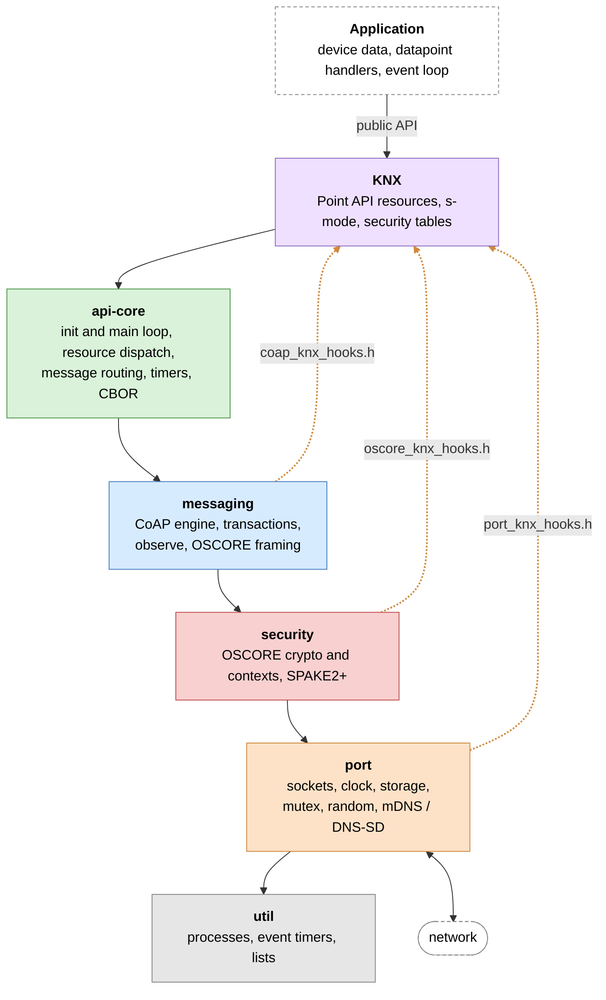
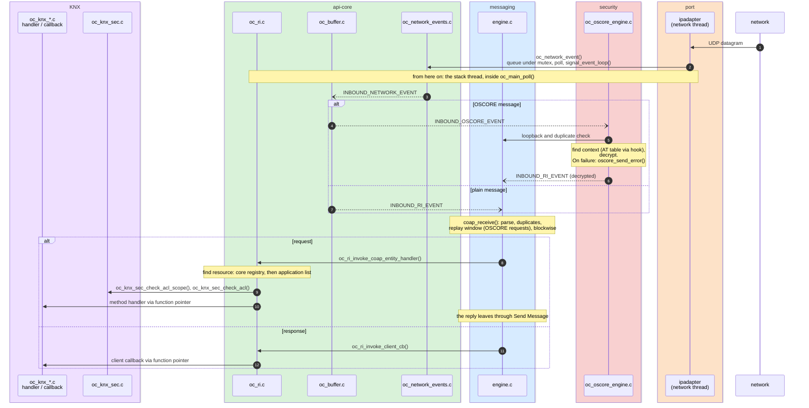
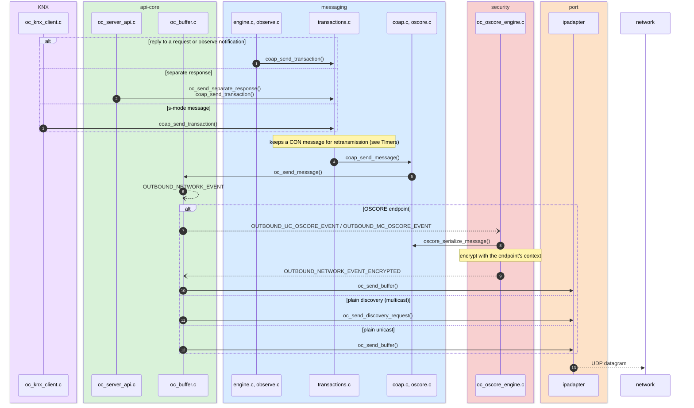
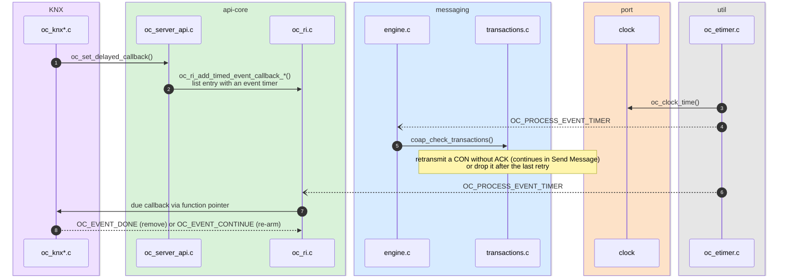
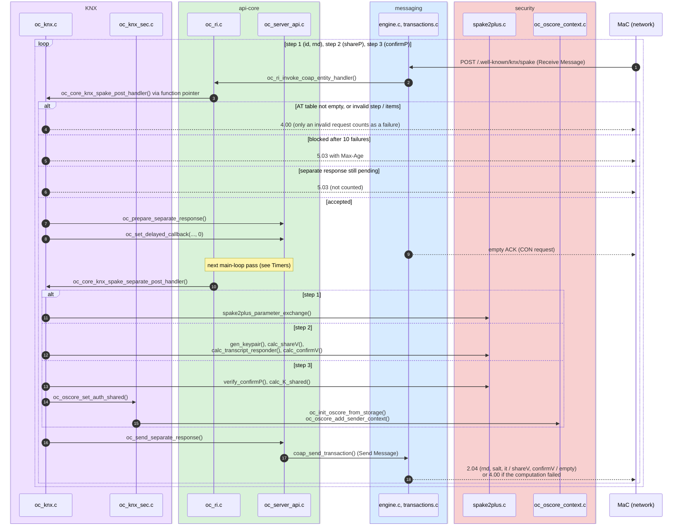
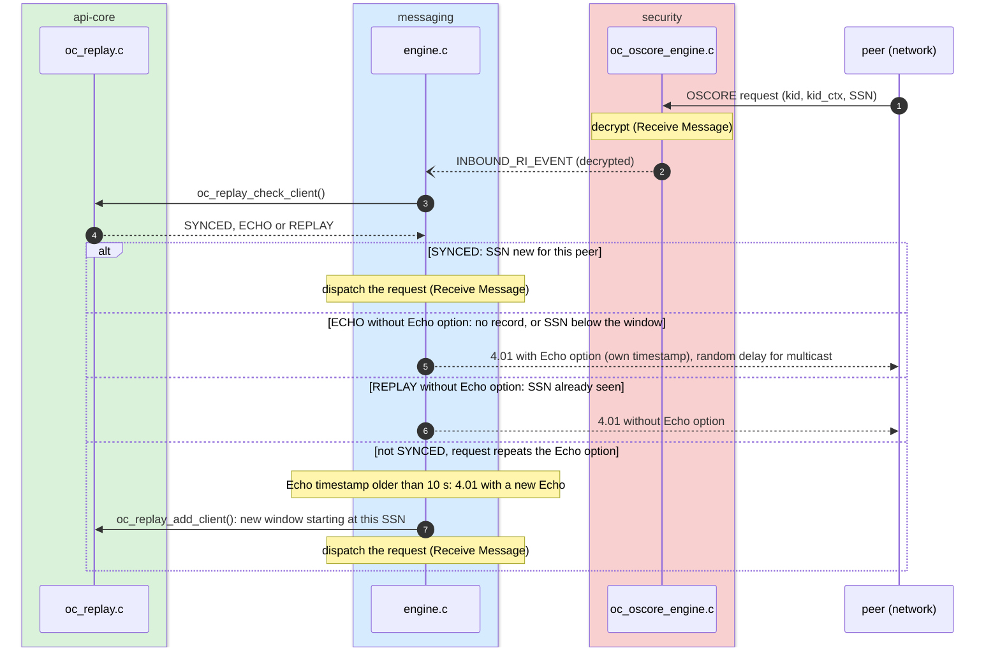
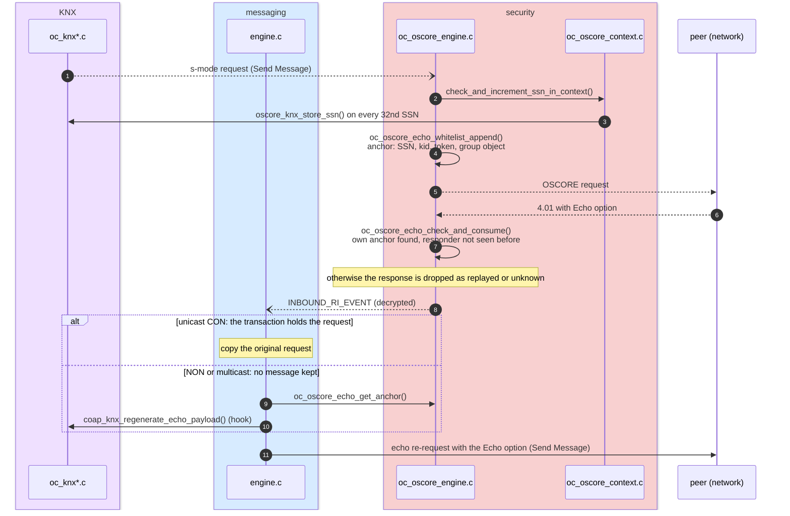

# Software Architecture and Design

This document explains how the production code of the KNX IoT Point API stack is organised, how a message travels through it, and why it is built this way. It describes the code as it is today. For the application view see [application-integration.md](application-integration.md).

## Design drivers

The stack implements the KNX IoT Point API (CoAP, OSCORE, SPAKE2+, mDNS) for Linux, Windows, Zephyr and RTOS. Three constraints shape most of the design:

- **Constrained devices.** The same code runs on microcontrollers with a few KiB of RAM. The stack therefore keeps fixed data in flash, sizes its tables at compile time, allocates messages only while they are in use, and caps the message queues (see [Memory](#memory-flash-for-fixed-data-ram-only-for-state)).
- **Many platforms, one core.** Everything that depends on the operating system (sockets, threads, clock, storage, random numbers, logging) sits behind small headers in `port/`. The rest of the code is identical on all platforms.
- **Integration into an existing application.** The stack does not own a thread. The application calls `oc_main_poll()` from its own loop, a dedicated thread or a UI timer. The stack wakes the loop when there is work.

The code base descends from IoTivity-Lite (`oc_` prefix, `api/`, `util/`) and Contiki (CoAP engine in `messaging/coap/`, protothreads in `util/`). Its structure follows from that origin, with a KNX application layer added on top.

## Layers

The stack has six layers. The colours below are used for these layers in every diagram of this document.

| Layer | Colour | Code | Responsibility |
|---|---|---|---|
| **KNX** | purple | `api/oc_knx*.c` | The KNX IoT Point API: `/dev`, `/fp`, `/p`, `/f`, `/auth`, `/swu`, `/.well-known/knx` and its sub-resources, s-mode group communication, the access token (AT) table, PASE, and the implementation of the hooks (`oc_knx_hooks.c`). |
| **api-core** | green | the other files in `api/`, public headers in `include/` | Generic stack core: `oc_main_init()` and `oc_main_poll()`, the resource directory and request dispatch (`oc_ri.c`, `oc_core_res.c`), message routing (`oc_buffer.c`, `oc_network_events.c`), the OSCORE replay window (`oc_replay.c`), server and client API, blockwise transfer, CBOR (`oc_rep.c`), discovery. |
| **messaging** | blue | `messaging/coap/` | CoAP parsing and serialisation, CON/NON transactions and retransmission, observe, separate responses, OSCORE message framing. |
| **security** | red | `security/` | OSCORE encryption, decryption, security contexts with their sender sequence numbers, and the echo ring (`oc_oscore_*.c`), SPAKE2+ (`spake2plus.c`), on top of PSA Crypto / Mbed TLS. |
| **port** | orange | `port/` and one directory per platform | Platform adaptation behind the headers in `port/`: sockets and the network receive thread, clock, storage, mutex, random numbers, logging, mDNS / DNS-SD. |
| **util** | grey | `util/` | Platform-independent building blocks: protothread processes and their event queue, event timers, lists, memory helpers. |

The arrows show the intended direction of use. The one boundary that is enforced is the hook rule in [Lower layers reach KNX only through hooks](#lower-layers-reach-knx-only-through-hooks).

## Design principles

### One thread runs the stack

All stack code runs on the thread that calls `oc_main_poll()`. Inside it, cooperative processes (protothreads from `util/oc_process.c`) take turns; none of them blocks and none is pre-empted. Only the hand-over from platform threads (and the message allocation they share) is protected by a mutex.

Platform threads stay at the edge. The network receive thread in the port hands a datagram over with `oc_network_event()`: it appends the message to a list under the network-event mutex, polls the `oc_network_events` process, and calls the application's `signal_event_loop()` to wake the main loop. Interface and address changes take the same way. The mDNS responder on the socket ports runs its own listener thread, which answers mDNS queries on its own socket.

Why: the core needs no thread or scheduler from the operating system, so it is the same on all platforms, and the application chooses how to drive the loop. The integration guide states the resulting rule for applications: call stack functions only from the thread that runs `oc_main_poll()`.

### Layers are coupled at runtime by events

A message moves between api-core, messaging and security as an event posted to the next process (see [Runtime model](#runtime-model)), not as a chain of direct calls. Each process does one job (route, encrypt or decrypt, run CoAP) and returns to the scheduler. The routing process decides once per message whether it goes through OSCORE, so senders and receivers do not handle encryption themselves.

### Lower layers reach KNX only through hooks

`messaging/`, `security/` and `port/` do not include KNX headers and do not call KNX functions. Each declares what it needs in its own header: `coap_knx_hooks.h` (s-mode echo payload, unicast result, echo delay), `oscore_knx_hooks.h` (AT table lookups, sequence number storage) and `port_knx_hooks.h` (group multicast join and leave, device info). `oc_knx_hooks.c` implements all of them as thin forwarders, and the linker connects the two sides; there is no registration and no function pointer.

The CTest `LayeringCheck.LowerLayersUseOnlyTheirKnxHooks` (script `check_layering.cmake`) fails the build when a file in these three layers includes an `oc_knx*.h` header or calls a function that a KNX header declares.

Why: the generic CoAP, OSCORE and platform code stays free of KNX knowledge, and every dependency on KNX is listed in one header per layer.

### Handlers and callbacks are function pointers

Resource handlers (`oc_request_handler_t` per CoAP method), client response callbacks and delayed callbacks are stored as function pointers and called by api-core. The dispatcher does not know which KNX or application function it calls, and application code is reached without a compile-time dependency.

### Memory: flash for fixed data, RAM only for state

- **Core resources are `const`.** Each KNX and core resource (for example `core_resource_sub`) is a `const oc_resource_t` defined in its source file, with `is_const = true`. A `const` registry in `oc_core_res.c`, indexed by `oc_core_resource_t`, lists them. The linker can place them in read-only memory (flash). The only per-resource RAM is a small `oc_resource_data_t` (observer count) that `runtime_data` points to. `oc_ri_add_resource()` and `oc_ri_delete_resource()` refuse `const` resources.
- **Application resources are on the heap.** `oc_new_resource()` allocates them, and `oc_ri.c` keeps them in a list. Dispatch looks at the core registry first (exact match or a trailing `*` wildcard) and then at the application list.
- **Messages are allocated per use.** The stack has no static message buffers. `oc_allocate_message()` allocates a message and its PDU buffer on the heap. The message is reference-counted. `oc_message_post()` is the single place that releases the reference when the target queue is full.
- **Message queues are capped.** Received messages waiting for the loop (`KNX_NET_MAX_RX_PENDING`), process events (`OC_PROCESS_MAX_EVENTS`) and open CoAP transactions (`KNX_COAP_MAX_OPEN_TRANSACTIONS`) have a limit. A message beyond the limit is dropped, and CoAP retransmission recovers it.
- **Tables are fixed-size.** The group object, publisher, recipient and AT tables are static arrays with a compile-time capacity. Only variable-length fields (hrefs, ids, group address lists) are allocated when an entry is written.

### Platform adaptation by link-time selection

`port/` declares the platform interface in small headers (`oc_connectivity.h`, `oc_clock.h`, `oc_storage.h`, `oc_random.h`, `oc_network_events_mutex.h`, `oc_log.h`, `dns-sd.h`). Each platform directory implements them and provides its own `oc_config.h` for compile-time sizes. The build links one implementation.

## Runtime model

`oc_main_init()` starts the stack: it resets the OSCORE state, calls `oc_ri_init()` (which starts the processes), loads the SPAKE2+ registration record, calls the application's `init()`, loads the KNX device data, registers the application resources, joins the group multicasts and announces the device through DNS-SD.

The application then calls `oc_main_poll()` in a loop. It runs `oc_process_run()` until no event is left and returns the time until the next timer, so the application can sleep until then or until `signal_event_loop()` wakes it.

`oc_ri_init()` starts six processes:

| Process | File | Layer | Job |
|---|---|---|---|
| `oc_network_events` | `oc_network_events.c` | api-core | takes received datagrams and interface events from the port |
| `message_buffer_handler` | `oc_buffer.c` | api-core | routes every inbound and outbound message, with or without OSCORE |
| `oc_oscore_handler` | `oc_oscore_engine.c` | security | decrypts inbound and encrypts outbound OSCORE messages |
| `coap_engine` | `engine.c` | messaging | processes CoAP messages (`coap_receive()`) and retransmissions |
| `timed_callback_events` | `oc_ri.c` | api-core | runs delayed callbacks (`oc_set_delayed_callback()`) |
| `oc_etimer_process` | `oc_etimer.c` | util | expires event timers and wakes the owning process |

The message events are defined in `oc_events.h`:

| Event | From | To |
|---|---|---|
| `INBOUND_NETWORK_EVENT` | `oc_network_events` | `message_buffer_handler` |
| `INBOUND_OSCORE_EVENT` | `message_buffer_handler` | `oc_oscore_handler` |
| `INBOUND_RI_EVENT` | `message_buffer_handler` (plain) or `oc_oscore_handler` (decrypted) | `coap_engine` |
| `OUTBOUND_NETWORK_EVENT` | `oc_send_message()` | `message_buffer_handler` |
| `OUTBOUND_UC_OSCORE_EVENT`, `OUTBOUND_MC_OSCORE_EVENT` | `message_buffer_handler` | `oc_oscore_handler` |
| `OUTBOUND_NETWORK_EVENT_ENCRYPTED` | `oc_oscore_handler` | `message_buffer_handler` |
| `INTERFACE_UP`, `INTERFACE_DOWN` | `oc_network_events` | `oc_network_events` (mDNS update) |
| `OC_PROCESS_EVENT_TIMER` | `oc_etimer_process` | `coap_engine`, `timed_callback_events` |

## Runtime flows

The sequence diagrams use the same conventions:

- Participants are ordered from left to right like the layers from top to bottom, with the network on the right. The boxes use the layer colours from [Layers](#layers).
- `->>` (solid) is a direct call. `--)` (dashed, open arrow) is an event posted to a process; it runs later on the same thread. `-->>` (dashed) is a return value or a response.

### Receive Message

A datagram arrives from the network and ends in a resource handler (request) or a client callback (response).

Plain and OSCORE messages share the same CoAP and dispatch path; the only difference is the detour through `oc_oscore_handler`. Access control is applied in the dispatcher for every request: a plain request reaches only methods without a scope (`OC_ACL_NONE`), every other method requires a decrypted OSCORE request whose access token has the scope. Application resources are dispatched the same way as the KNX resources shown here.

### Send Message

Replies, separate responses, observe notifications and s-mode messages all end in `coap_send_message()` and `oc_send_message()`, so every sender shares the same OSCORE and port path.

The `/.well-known/core` discovery request in `oc_client_api.c` calls `coap_send_message()` directly, without a transaction. The OSCORE decision is made once, in `message_buffer_handler`, from the endpoint flags; senders do not encrypt themselves.

### Timers and delayed callbacks

Timers drive CoAP retransmission and the delayed callbacks that KNX (for example the SPAKE2+ handshake and its brute-force timer) and mDNS (announcement repeat, update retry) use.

A delayed callback with a delay of 0 runs on the next main-loop pass. This is how a handler defers long work out of the receive path.

### PASE commissioning with SPAKE2+

During commissioning, the management client (MaC) and the device derive a shared OSCORE key through a password-authenticated key exchange (PASE) with SPAKE2+. It needs no message path of its own; it combines the flows above: [Receive Message](#receive-message) delivers each request to the KNX handler, [Timers and delayed callbacks](#timers-and-delayed-callbacks) defers the elliptic-curve work into a delayed callback, and [Send Message](#send-message) returns the result as a separate response.

| Step | Request from MaC | Device computes in `spake2plus.c` | Response |
|---|---|---|---|
| 1 Parameter exchange | `id`, `rnd` | `spake2plus_parameter_exchange()`; `salt` and `it` come from the registration record | 2.04 with `rnd`, `salt`, `it` |
| 2 Credential exchange | `shareP` | key pair, `shareV`, transcript, `confirmV` | 2.04 with `shareV`, `confirmV` |
| 3 Verification | `confirmP` | `verify_confirmP()`, `calc_K_shared()` | 2.04, empty |

Design decisions visible in `oc_knx.c` and `oc_knx_sec.c`:

- **Only in the default state.** PASE is accepted only while the AT table is empty. The code comment gives the reason: otherwise an attacker could set their own PASE token and read what the MaC writes later.
- **No password on the device.** The device holds only the precalculated registration record (`w0`, `L`, `salt`, `it`) that the application returns from `app_get_precalculated_spake_data()`. `oc_spake2plus_init_data()` loads it during `oc_main_init()`, and initialisation fails without it.
- **A state table enforces the order.** `spake_event_to_state` checks each request against the session state and the expected number of items; step 3 is accepted only after step 2 has been computed. An invalid request resets the session.
- **Brute-force protection.** The tenth consecutive failure blocks PASE. A delayed callback lowers the counter every 6 seconds, so the device is unblocked after 60 seconds; meanwhile it answers 5.03 with `Max-Age` set to the remaining time. A successful handshake or a device reset clears the counter.
- **One handshake at a time.** There is a single PASE session and a single separate-response handle. A second request while a response is pending is answered 5.03 and does not count as a failure.
- **Expensive work off the receive path.** The request handler only validates the request; the elliptic-curve operations run in the delayed callback, after the empty ACK has been sent.
- **The result is an ordinary OSCORE context.** After step 3, `oc_oscore_set_auth_shared()` writes the shared key as a PASE token (`if.sec` scope) into the AT table, stores it, and rebuilds the OSCORE contexts. From then on the MaC uses the OSCORE path of [Receive Message](#receive-message) and [Send Message](#send-message). Intermediate key material is wiped with `spake2plus_wipe()`.

### OSCORE sequence numbers and replay protection

OSCORE uses the sender sequence number (SSN) of each message as the nonce for encryption and as the input for replay protection. The stack keeps this state in three places:

| State | Where | Kept in | Purpose |
|---|---|---|---|
| Own SSN per sender context | `oc_oscore_context.c` (security) | RAM, saved in the AT entry every 32 SSNs through the `oscore_knx_store_ssn` hook | never send the same SSN twice with the same key |
| Replay window per peer | `oc_replay.c` (api-core), called by `engine.c` (messaging) | RAM only | accept each inbound SSN of a peer only once |
| Echo ring | `oc_oscore_engine.c` (security) | RAM only | accept a 4.01 Echo response to an own s-mode request only once |

#### Device as receiver: replay window and Echo

Every decrypted OSCORE request is checked against the replay record of its sender, found by sender ID (`kid`) and ID context (`kid_ctx`). The record holds the highest SSN received and a 32-bit window (`OSCORE_REPLAY_WINDOW_SIZE`) that marks which of the 32 SSNs below it have been seen. If the device has no record or the SSN lies below the window, it cannot decide, so it asks the peer to prove freshness with an Echo challenge (RFC 9175).

#### Device as sender: own SSN and the echo ring

Each protected message increments the SSN of the sender context; a CON retransmission reuses it. When a peer answers an own s-mode request with 4.01 and an Echo option, the device repeats the request once, with the Echo option. The echo ring makes sure this happens only for requests the device really sent, and only once per responder.

Design decisions visible in `oc_oscore_context.c`, `oc_replay.c`, `engine.c` and `oc_oscore_engine.c`:

- **The SSN is saved in steps, and padded after a restart.** The SSN is saved every 32 messages (`OSCORE_SSN_WRITE_FREQ_K`). When the contexts are rebuilt from storage at start-up, device reset or restart, the stored SSN is raised by 32 plus a padding (`OSCORE_SSN_PAD_F`) and saved again at once. The code comment cites RFC 8613, Appendix B.1.1: an SSN that was used but not yet saved, or a failed write, must not lead to a reused SSN.
- **The SSN never wraps.** At `OSCORE_SSN_MAX` the context refuses to send, because a wrap would reuse an encryption nonce. Only new keys from the MaC make the device send again.
- **Replay state is not persisted.** Replay records and the echo ring live in RAM and are cleared at start-up, at shutdown and when the AT table is deleted. A peer without a record is not rejected but challenged with Echo, so after a restart each peer re-synchronises with one extra round trip.
  > **Note for products:** in a product, the replay state must be stored in non-volatile memory so that it survives a restart.
- **Bounded memory.** There is one replay record per entry of the publisher table (or the recipient table if there is none); when all are in use, the record with the oldest receive time is replaced. The echo ring has 16 slots (`KNX_ECHO_RING_SIZE`) and is overwritten in order.
- **Echo is the device's own clock.** The Echo value is a timestamp of the device. A repeated request is accepted only if the echoed timestamp is at most 10 seconds old (`OC_ECHO_FRESHNESS_TIME`).
- **The echo ring keeps a reference, not the message.** An anchor stores the group object and service type instead of the sent message, which would hold a full PDU buffer per slot. The re-request therefore carries the current value of the group object, which the code comment states is allowed by the KNX specification (clause 3.6.4.1.3). The ring has no timeout, so that answers from sleepy devices are still accepted.

## Glossary

Function names follow `oc_<module>_<action>`, for example `oc_ri_invoke_client_cb()` in `oc_ri.c`. The CoAP code uses `coap_`, the KNX layer `oc_knx_` or `oc_core_knx_`, and the hooks `<layer>_knx_`.

| Term | Meaning |
|---|---|
| ACL | Access control: each resource method has a scope mask (`acl_scope_mask`) that the AT entry of the requester must match. |
| AT | Access token. The AT table (`/auth/at`) holds the tokens and the OSCORE keys derived from them. |
| Echo | CoAP option (RFC 9175) that the device uses to make a peer prove that a request is fresh. |
| MaC | Management client, the tool that commissions and configures the device, for example ETS. |
| OSCORE | Object Security for Constrained RESTful Environments (RFC 8613). It protects CoAP messages end to end. |
| PASE | Password-authenticated session establishment. During commissioning it derives the first OSCORE key with SPAKE2+. |
| Process | A cooperative protothread (`OC_PROCESS`) scheduled by `oc_process_run()`. |
| RI | Resource implementation, the resource layer in `oc_ri.c`: resources, request dispatch, client callbacks and timed callbacks. |
| Separate response | A CoAP response sent later than the empty ACK for the request (RFC 7252, section 5.2.2). |
| SPAKE2+ | Augmented password-authenticated key exchange (RFC 9383). |
| SSN | Sender sequence number. The OSCORE Partial IV of a message; it is unique per sender key. |
| s-mode | KNX system mode: group communication between devices through group objects. |
